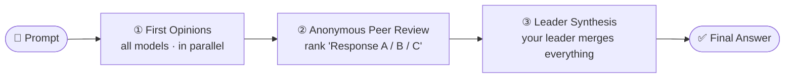
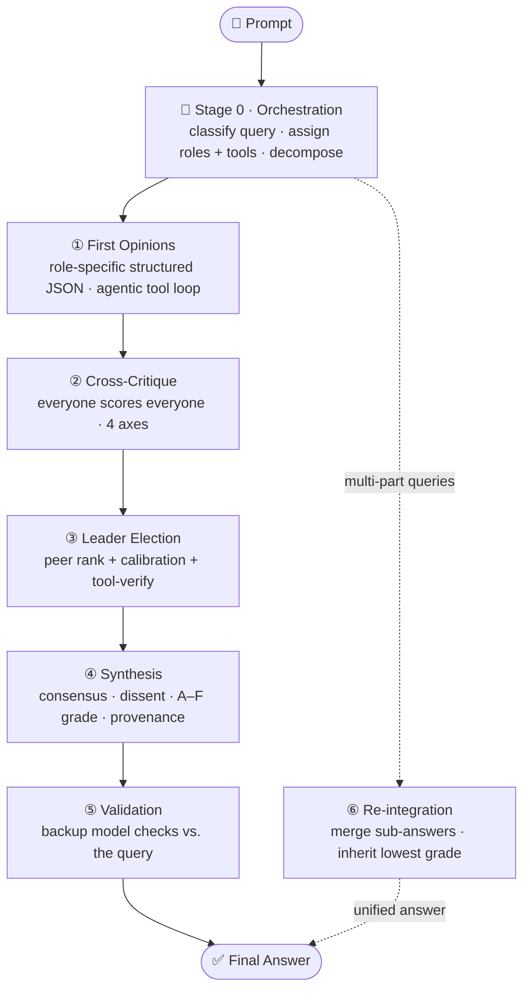

<div align="center">

# 🏛️ Model Senate

### Ask once. Convene many minds. Get one researched answer.

**Model Senate** sends a single prompt to several frontier models, has them **debate and anonymously peer-review each other**, then synthesizes one answer that surfaces **consensus, dissent, and what still needs checking** — instead of trusting a single model's blind spots.

<br/>

[](https://www.python.org/)
[](https://fastapi.tiangolo.com/)
[](https://react.dev/)
[](#-configuration)
[](LICENSE)
[](#-contributing)

<samp>[**Why**](#-why-it-exists) · [**How it works**](#-how-it-works) · [**Features**](#-features) · [**Quickstart**](#-quickstart) · [**Configuration**](#-configuration) · [**API**](#-api-reference) · [**Contributing**](#-contributing)</samp>

</div>

---

<div align="center">

> ### 🗳️ *Truth beats majority vote.*
> The synthesis stages are explicitly instructed that a **well-supported minority view wins over false consensus.**
> Dissent is preserved and attributed — never averaged away.

</div>

---

## 💡 Why It Exists

A single model has a single set of blind spots. It can miss context, overstate weak claims, hallucinate confidently, or lean toward one style of reasoning. Asking three or four *different* models the same question — and making them **critique one another** — turns those independent blind spots into a measurable signal.

Model Senate automates that loop so you never copy a prompt between provider tabs again. Reach for it when **calibrated confidence matters more than a fast guess**:

<div align="center">

| 📈 Investment research | 🏗️ Architecture decisions | 📚 Literature reviews |
|:---:|:---:|:---:|
| ⚖️ **Ethics & policy** | 🐛 **Code review** | 🔬 **High-stakes analysis** |

</div>

---

## 🧭 How It Works

Model Senate ships **two complementary deliberation pipelines** that share the same providers, storage, and UI — pick speed or depth.

<div align="center">

| | 🏛️ **Model Senate** | 🗳️ **Model Council** |
|---|---|---|
| **Stages** | 3 | 5–6 |
| **Leader** | Pre-designated by you | **Elected** from scored performance |
| **Roles** | Uniform | Per-model (Fact Verifier, Devil's Advocate, …) |
| **Output** | Prose synthesis | Structured JSON — consensus / dissent / unresolved / provenance |
| **Tools** | — | Calculator · sandboxed code · web search *(agentic loop)* |
| **Delivery** | Synchronous | Async + **live, resumable SSE** |
| **Best for** | Fast multi-model second opinions | High-stakes, auditable deliberation |

</div>

### 🏛️ Model Senate — 3-Stage Pipeline



1. **First opinions** — every selected model answers independently, in parallel.
2. **Anonymous peer review** — each model receives the *other* answers labeled `Response A`, `Response B`, … and ranks them. Rankings are parsed from a `FINAL RANKING:` block and de-anonymized afterward for auditability.
3. **Leader synthesis** — your chosen leader model combines the opinions, reviews, and aggregate rankings into one final answer.

### 🗳️ Model Council — 5-to-6-Stage Pipeline



0. **Orchestration** — an orchestrator model classifies the query (`factual`, `analytical`, `code`, `ethics`, `creative`, `multi_part`), assigns each model a role, and derives tool permissions. Falls back to heuristics if the call fails.
1. **First opinions** — models answer in role and return structured opinions (`answer`, `confidence`, `key_claims`, `uncertainties`) via native JSON mode. Assigned tools run in an **agentic loop**: `TOOL_CALL:` directives execute and their results feed back into the next turn so they *inform* the answer.
2. **Cross-critique** — every successful model scores every other model on accuracy, logic, completeness, and calibration.
3. **Leader election** — candidates are scored on **peer rank, confidence calibration, and tool-verified claims** (base weights `0.40 / 0.30 / 0.30`; the tool weight is redistributed when no verifiable claims exist). A cleanly-structured opinion is preferred for the chair, and a **leader + backup validator** are elected.
4. **Synthesis** — the elected leader produces a structured answer with consensus, dissent, unresolved conflicts, a confidence grade (**A–F**), a provenance map, and recommended next checks. Retries with the backup on failure.
5. **Validation** — the backup model independently checks the synthesis and returns `approved`, `approved_with_caveats`, or `flagged`.
6. **Re-integration** *(multi-part only)* — composite questions are decomposed, each sub-question runs its own Council, and a re-integration agent assembles a unified answer that inherits the lowest sub-grade and surfaces cross-answer contradictions.

> The Council runs asynchronously: `POST /api/council/run` returns a `run_id` immediately, and the UI streams every stage live over Server-Sent Events. A dropped connection **resumes without gaps** via `Last-Event-ID`.

---

## ✨ Features

- 🌐 **Multi-provider fan-out** — OpenRouter (one key, many models), plus direct OpenAI, Anthropic, Google, xAI, and Groq adapters.
- 🕵️ **Anonymous peer review** — models rank work by blind label; identities are revealed only after completion.
- 🏆 **Elected leadership** — the Council promotes whichever model actually performed best *on this query*, not a fixed favorite.
- 🧾 **Structured, auditable output** — consensus / dissent / unresolved splits, A–F confidence grades, and a provenance tree linking each claim to its source, validators, and challengers.
- 🔧 **Real tool use** — a safe AST calculator, optional sandboxed Python, and pluggable web search (Tavily / Serper / Brave), run in an **agentic loop** so results shape the final answer.
- 🎯 **Reliable structured output** — native JSON mode (OpenAI `response_format`, Anthropic prefill, Gemini `responseMimeType`) with a resilient regex fallback.
- 🎛️ **Reproducible & tunable** — per-route `temperature`, `top_p`, `max_tokens`, and `seed`; set `temperature=0` for deterministic runs.
- 📡 **Live, resumable streaming** — reasoning types out token-by-token and every stage streams over SSE; reconnects replay missed events.
- 💰 **Full cost & token accounting** — totaled across *every* stage (opinions, critique, synthesis, validation, orchestration), with dollar cost where the provider reports it.
- 🛡️ **Resilient by default** — automatic retry-with-backoff on transient provider errors and a global concurrency cap.
- 🎨 **Editorial light & dark themes** — a parchment "day chamber" and a gold-on-charcoal "night chamber," remembered across sessions.
- 🔒 **Local-first** — every run is stored as plain JSON under `data/conversations/`. Keys never touch the saved files.

---

## 🚀 Quickstart

> **One-command install (once published to PyPI):** `pipx install model-senate` → run `model-senate`. It serves the API and bundled UI together and opens your browser. The steps below are the from-source developer setup.

### Prerequisites

- [Python 3.10+](https://www.python.org/) and [`uv`](https://docs.astral.sh/uv/)
- [Node.js 18+](https://nodejs.org/) and `npm`
- At least one provider API key ([OpenRouter](https://openrouter.ai/) is the simplest)

### 1 · Install dependencies

```bash
uv sync                               # backend (Python)
cd frontend && npm install && cd ..   # frontend (TypeScript/React)
```

### 2 · Configure keys

```bash
cp .env.example .env
```

One OpenRouter key unlocks every default model:

```env
OPENROUTER_API_KEY=sk-or-v1-your-key
```

Direct provider keys are optional and used automatically when present:

```env
OPENAI_API_KEY=
ANTHROPIC_API_KEY=
GOOGLE_API_KEY=
XAI_API_KEY=
```

### 3 · Run

```bash
./start.sh                 # macOS / Linux  — backend + frontend together
.\start.ps1                # Windows PowerShell
```

<details>
<summary><b>Or run each server manually</b></summary>

```bash
# Terminal 1 — backend on http://127.0.0.1:8001
uv run python -m backend.main

# Terminal 2 — frontend on http://localhost:5173
cd frontend && npm run dev
```

</details>

Then open **http://localhost:5173** — the Vite dev server proxies `/api/*` to the backend on port `8001`.

---

## ⚙️ Configuration

All settings are read from `.env` (see `backend/config.py`).

| Setting | Default | Purpose |
|---|---|---|
| `OPENROUTER_API_KEY` | — | Primary multi-model key |
| `OPENAI_API_KEY` / `ANTHROPIC_API_KEY` / `GOOGLE_API_KEY` / `XAI_API_KEY` / `GROQ_API_KEY` | — | Optional direct provider keys |
| `MODEL_SENATE_HOST` / `MODEL_SENATE_PORT` | `127.0.0.1` / `8001` | Backend bind address |
| `FRONTEND_ORIGIN` | `http://localhost:5173` | Allowed CORS origin |
| `ORCHESTRATOR_MODEL_ID` | `openrouter-gpt-5-2` | Model used for Council Stage 0 |
| `COUNCIL_MIN_MODELS` | `2` | Minimum models for a Council run |
| `COUNCIL_SYNTHESIS_RETRY_ON_FAILURE` | `true` | Retry synthesis with the backup if the leader fails |
| `COUNCIL_MAX_TOOL_ITERATIONS` | `3` | Max model turns per opinion when tools are used (results fed back each turn) |
| `PROVIDER_TIMEOUT_SECONDS` | `90` | Per-request timeout |
| `PROVIDER_MAX_RETRIES` | `2` | Retries on transient (429 / 5xx / network) errors, with backoff |
| `MAX_CONCURRENT_REQUESTS` | `8` | Global cap on simultaneous provider calls |
| `TOOL_CODE_EXECUTOR_ENABLED` | `false` | Enable sandboxed Python execution |
| `TOOL_CODE_EXECUTOR_TIMEOUT_SECONDS` | `10` | Code execution timeout |
| `TOOL_WEB_SEARCH_ENABLED` | `false` | Enable web search |
| `TOOL_WEB_SEARCH_PROVIDER` | `tavily` | `tavily`, `serper`, or `brave` |
| `TAVILY_API_KEY` / `SERPER_API_KEY` / `BRAVE_SEARCH_API_KEY` | — | Web search provider keys |

<details>
<summary><b>Custom model routes</b></summary>

Default routes live in `backend/config.py`. Override them entirely by setting `MODEL_SENATE_ROUTES` to a JSON array. Each route may pin generation params for reproducibility:

```json
[
  {
    "id": "openrouter-gpt-5-2",
    "provider": "openrouter",
    "model": "openai/gpt-5.2",
    "display_name": "GPT-5.2 via OpenRouter",
    "supports_streaming": true,
    "temperature": 0
  }
]
```

The UI flags any route whose local key is missing — without ever revealing the key value.

</details>

---

## 🔌 API Reference

| Method | Path | Purpose |
|---|---|---|
| `GET` | `/api/health` | Liveness check |
| `GET` | `/api/config` | Available models + defaults for both pipelines |
| `POST` | `/api/senate/run` | Run the Senate pipeline (synchronous → `SenateRun`) |
| `GET` | `/api/conversations` | List past Senate runs |
| `GET` | `/api/conversations/{run_id}` | Fetch a Senate run |
| `POST` | `/api/council/run` | Start the Council pipeline → `{ "run_id": … }` |
| `GET` | `/api/council/run/{run_id}/stream` | Live SSE stream of Council stage events (resumable via `Last-Event-ID`) |
| `GET` | `/api/council/run/{run_id}` | Fetch a completed Council run |
| `GET` | `/api/council/runs` | List past Council runs |

---

## 🔧 Tools

Tools are opt-in and assigned to roles by the orchestrator. Council models invoke them inline; results feed back into the next turn (an **agentic loop**) and factor into the election's tool-verification score:

```
TOOL_CALL: {"tool": "calculator", "expression": "1.07 ** 10"}
TOOL_CALL: {"tool": "web_search", "query": "current US 10-year treasury yield"}
```

| Tool | Default | Notes |
|---|---|---|
| `calculator` | ✅ always on | Safe AST evaluator — no `eval`, arithmetic only |
| `code_executor` | off | Runs Python in a timeout-bounded subprocess; enable with `TOOL_CODE_EXECUTOR_ENABLED=true` |
| `web_search` | off | Tavily / Serper / Brave; enable with `TOOL_WEB_SEARCH_ENABLED=true` and a provider key |

---

## 🧪 Testing

```bash
uv run pytest                  # backend (async, respx HTTP mocking)
cd frontend && npm test        # frontend (Vitest)
cd frontend && npm run build   # type-check + production build
```

---

## 📦 Building a Release

The wheel bundles the production UI so a single `pipx install` ships everything:

```bash
python scripts/bundle_frontend.py   # builds the frontend → backend/static/
uv build                            # produces dist/*.whl with the UI inside
```

In development the server falls back to serving `frontend/dist/` directly, so you don't need to bundle while iterating.

---

## 🗂️ Project Structure

```
backend/
  main.py          FastAPI app, routes, singletons, static UI serving
  cli.py           `model-senate` console entry point
  config.py        Settings + model routes
  schemas.py       Pydantic DTOs (SenateRun / CouncilRun)
  senate.py        3-stage Senate pipeline
  council.py       5–6-stage Council pipeline (incl. agentic tool loop)
  orchestrator.py  Stage 0 — query classification & role assignment
  roles.py         Agent / critique roles and prompt builders
  election.py      Stage 3 — leader scoring & election
  validator.py     Stage 5 — synthesis validation
  reintegrator.py  Stage 6 — multi-part re-integration
  tools.py         Calculator, code executor, web search
  streaming.py     Resumable SSE event stream for the Council
  providers.py     Provider adapters (OpenRouter / OpenAI / Anthropic / Google / xAI / Groq)
frontend/src/
  App.tsx          Senate + Council workspaces, models & history views
  api.ts           Typed fetch helpers
  hooks/           useCouncilStream — live SSE consumer
  types.ts         TS mirrors of the backend schemas
scripts/
  bundle_frontend.py   Builds the UI into backend/static for release wheels
tests/             pytest suites for senate, council, election, tools, providers, streaming, config
docs/
  architecture.md      Full pipeline contract & design notes
  ROADMAP.md           Quality & proof roadmap (eval harness, debate, calibration)
  NEXT_STEPS.md        Distribution & product plan (local models, MCP, as-a-model API)
```

---

## 🔐 Privacy

Model Senate is local-first. Prompts and responses are stored only on your machine as JSON under `data/conversations/`. API keys live in `.env` / your process environment and are **never** written to conversation files or returned by the API.

## ⚠️ Limitations

This is a local research tool, not a hosted multi-tenant service. Output quality depends on the models, providers, and keys you supply. For high-stakes financial, medical, or legal decisions, treat Model Senate as a research aid and verify against primary sources or qualified professionals.

## 🤝 Contributing

Issues and pull requests are welcome! Please run `uv run pytest` and `npm test` before opening a PR, and keep changes surgical and well-scoped — see [`CLAUDE.md`](CLAUDE.md) for the project's engineering conventions, [`docs/architecture.md`](docs/architecture.md) for the deeper design contract, and [`docs/ROADMAP.md`](docs/ROADMAP.md) / [`docs/NEXT_STEPS.md`](docs/NEXT_STEPS.md) for where it's headed.

## 📄 License

[MIT](LICENSE) © 2026 Jitendra Jha

<div align="center">
<br/>

**⭐ If Model Senate helped you reason better, consider starring the repo.**

<sub>Built for people who'd rather ask a council than gamble on one model.</sub>

</div>
